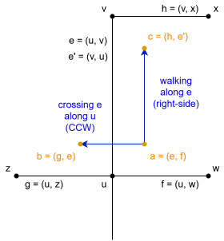

# Graph generation

## Preliminaries

We will assume that we are working with a fully bidirectional multigraph; that
is, every edge $(u, v, k)$ (where $k$ differentiates multiple possible road
segments that share an origin and destination) implies the existence of an
opposing edge $(v, u, k)$. This makes sense for our purposes, because
pedestrian movement is never one-way. In the rest of this document, we will
not write $k$ to reduce cluttering, but do remember that it exists to
differentiate road segments with the same origin and destination.

We will divide road types into the following categories:
- Major roads: motorways and trunk roads; primary, secondary and tertiary
  roads. These have significant vehicular flow, and so should not be crossed
  unless explicitly allowed.
- Minor roads: Residential and unclassified roads. These have a lower
  vehicular flow, and so can be crossed unless it is specifically disallowed.
- Pedestrian roads: places where a pedestrian is meant to walk on, not next
  to. This includes sidewalks when mapped separately from the road. They can
  also always be crossed, unless specifically disallowed.
- Service roads, living roads, cycleways and others. These are assumed to have
  no high-speed vehicular flow; they are treated like minor roads, with some
  exceptions (see [Intersections near traffic
  signals](#intersections-near-traffic-signals)).

## New graph structure

The basic idea behind this package is that, for every node $u$ in the original
graph (we will call these "base nodes" from now on), we will create
**intermediate nodes** representing the space where a pedestrian should stand.

In the figure below, black dots and lines represent the original nodes and
edges of the street graph (pedestrian roads are thin lines; non-pedestrian
roads are thick lines). Orange dots represent the new intermediate nodes that
are created in each case.

If there are two adjacent edges representing non-pedestrian roads (leftmost
graph), we add an intermediate node between these two edges (signifying that a
pedestrian can stand on the space between these two street segments). If there
is a pedestrian road between two adjacent edges representing non-pedestrian
roads (center graph), then we add an intermediate edge on top of the
pedestrian road itself (because that is where a pedestrian would stand in this
case). If all outgoing edges from a base node represent pedestrian roads
(rightmost graph), then we only add an intermediate node on the intersection
itself (because the pedestrian would be able to stand there).

We will only allow travel between these intermediate nodes. This can occur in
one of two ways:
- **Crossing a road $e$ along a base node $u$**, connecting two intermediate
  nodes, $a$ and $b$, on either side of $e$. Depending on the direction of
  travel and the positions of $a$ and $b$ in relation to $u$, this can either
  be a "clockwise crossing" or a "counterclockwise crossing".
- **Walking along a road $e$**, between two intermediate nodes, $a$ and $c$.
  Every base edge (as seen from its origin) will have an intermediate node to
  its left and one to its right; in the case of the first two graphs above,
  $e$' left-side node is $b$, and its right-side node is $a$. We will be able
  to walk from $e$'s right-side node to $e'$'s left-side node (a "right-side
  walk"), and from $e$'s left-side node to $e'$'s right-side node (a
  "left-side walk"). If $e$ is a pedestrian road (rightmost graph above), we
  will be walking on the road itself, so we will call this a "center-side
  walk".

### Crossing roads

Given a base node $u$, we will consider it **safe** if it's a marked or
controlled crossing, and we will consider it **unsafe** if crossing along the
node is prohibited. Nodes that are neither safe nor unsafe will be considered
**neutral**.

Given a road $e$, we will consider it **crossable** if it is not a major road.

With these two concepts, we can introduce our first two rules:

> If a road $e$ is crossable, you can always cross it along a base node $u$,
> unless $u$ is unsafe.

> If a road $e$ is not crossable, you can only cross it along a base node $u$
> if u is safe.

This implies that it is only safe to cross a major road if there is an
explicit marking for pedestrians to cross along, avoiding the problem that
motivated part of this package.

### Walking along roads

For walking along roads, there is only one rule:

> You can always walk along a side of the road, unless there is no sidewalk on
> that side, or the sidewalk is mapped separately (in that case, you should be
> walking on the edges representing the sidewalk, not along the main road).

## Edge cases and other fixes

### Walking along the boundary

There are some problems when walking along roads on the boundary of our
original graph. Because there are no roads outside the boundary, the algorithm
will assume that you can safely walk along the entire outer edge of the study
area, which is not necessarily the case and might introduce routing errors
(where the algorithm makes you walk along the boundary to avoid unsafe
crossings, inadvertently making you walk across roads it didn't know existed).
Because of this, we will add an extra rule:

> If $u$ is a base node on the boundary of the study area, then no
> intermediate nodes will be created around $u$.

We will consider a base node $u$ to be on the boundary of the study area if
its `street_count` attribute is different from its out-degree. OSMnx actually
considers roads outside its boundaries for street counts, so a mismatch
between these two values means there is an outgoing road from this node that
is not present in the graph.

### Intersections near traffic signals

There is an extra rule that helps when combining traffic signals and minor
roads. Take this intersection in Providencia, Santiago:

Because Román Díaz is residential (and no separate sidewalk is marked on the
main road), the algorithm assumes that you can walk along Román Díaz to the
intersection with Francisco Bilbao, and cross Román Díaz along the south side
of Francisco Bilbao (orange arrows). In reality, you should be using the
designated crossing place on the sidewalk (blue arrows). To solve this, we add
one more rule:

> If a base node $u$ is near traffic signals, but it is not a safe node, then
> it is marked as unsafe.

We use network distance (not euclidean distance) to calculate whether a
traffic signal is close enough to $u$; by default, it must be no more than 20
meters away, but this can be changed. This network distance only considers
major and minor roads; it doesn't travel through pedestrian roads or other
ways (like service roads or living streets).

### Mislabeled crossings

One common mistake in Santiago's OpenStreetMap data is to label pedestrian
crossings with traffic signals with the `crossing=marked` tag, instead of the
correct `crossing=traffic_signals` tag. Because of this, we will add an
optional rule:

> If a crossing with the `crossing=marked` tag is near traffic signals, it
> will be changed to the `crossing=traffic_signals` tag.

This is obviously not going to be correct in all cases, but it is a temporary
heuristic while a more permanent fix (retagging all incorrect crossings) is
worked on.