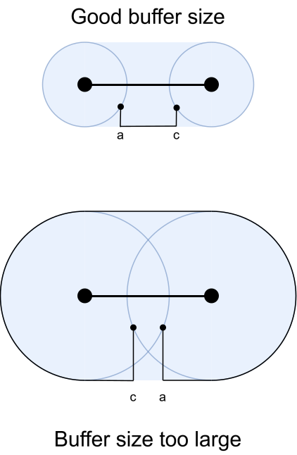

# Geometry buffering

The crossing graph, as generated by the default `generate_crossing_graph`
function, is completely functional in terms of the graph itself. However, the
geometries are taken directly from the base graph: intermediate nodes are all
positioned at their base node, crossings along a base node are also
represented by the base node's geometry (a point, even though the crossing
should be a line), and walks along an edge $e$ are represented by $e$'s
geometry (which means it's impossible to differentiate a left-side walk from a
right-side walk). Consequently, we need to redefine these geometries so that
they are all unique.

We will base our definitions on one parameter, a **buffer distance** we will
call $b$. By default, $b$ will be 1 meter, but this value can be changed.

## Intermediate nodes

All intermediate nodes will be positioned $b$ meters away from their base
node, with the angle of movement defined by the following:

- If the intermediate node was generated between two non-pedestrian roads, the
  angle of movement away from the base node will be the angle bisector between
  the roads.
- If the intermediate node was generated on top of a pedestrian way, the angle
  of movement will be in the direction of the way.
- In the special case that the intermediate node was generated on the end of a
  one-way street, the angle of movement will be opposite the direction of the
  street.

## Intermediate edges

For crossings, we will simply connect the two intermediate nodes (considering
their new geometries) with a straight line.

For walks along an edge, there are two possible cases. We will assume we are
walking along an edge $e$ between intermediate nodes $a$ and $c$:

If it's a walk along the side of a non-pedestrian way, we:
- Buffer the original edge $b$ meters
- Project $a$ and $c$ onto the exterior ring of the buffered edge.
- Connect $a$ and $c$ to their projections with straight lines (if they are
  not already on top of the ring).
- Connect the projections along the ring (clockwise if it's a left-side walk,
  counterclockwise if it's a right-side walk).

If it's a walk on top of a pedestrian way, we:
- Project $a$ and $c$ onto the pedestrian way.
- Connect $a$ and $c$ to their projections with straight lines (if they are
  not already on top of the way).
- Connect the projections following the geometry of the original way.

The figure below shows two walks (thin black lines) along the sides of
non-pedestrian ways (thick black lines). The intermediate nodes (small black
dots) are all $b$ meters away from their base nodes (large black dots). The
blue and orange shapes show the buffered edges. The vertical walk connects two
intermediate nodes that are already on top of their corresponding ring, while
the horizontal walk has one intermediate node that is not on top of the ring
and is connected with a straight line to its projection.

## Buffer distance choice

The buffer distance must not be too large compared to the smallest
non-pedestrian road segments.

Let's take the example from the figure below, where we are creating the
geometry for a right-side walk from $a$ to $c$. If the buffer distance is too
large, the two intermediate nodes might end up inverted. When this happens, a
counterclockwise walk along the buffered edge's exterior (which is the correct
way, since this is a right-side walk) actually takes the long way around the
edge instead of the shorter way.

