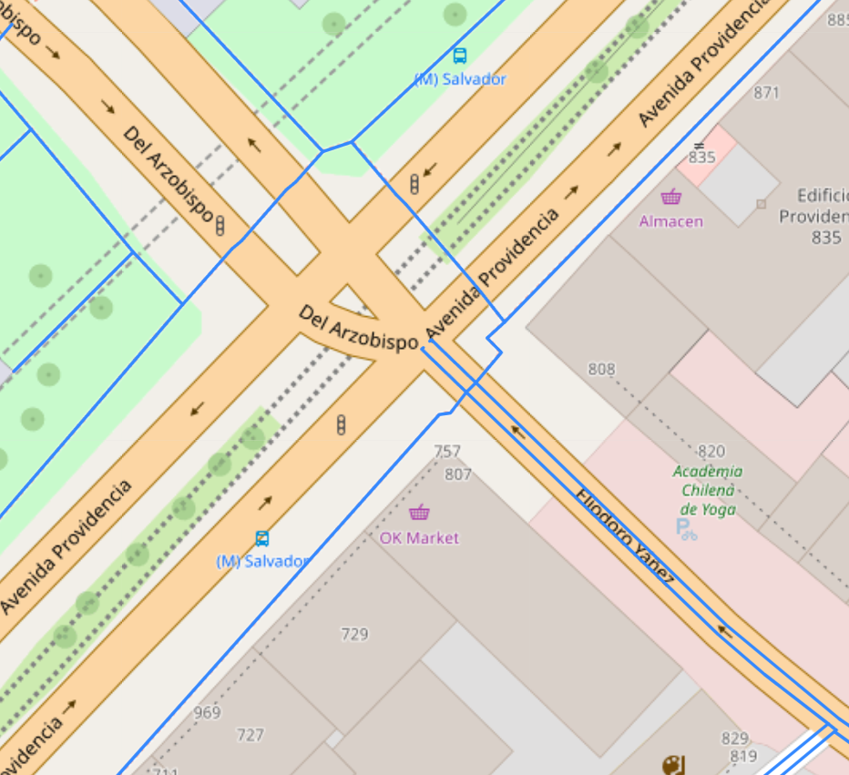
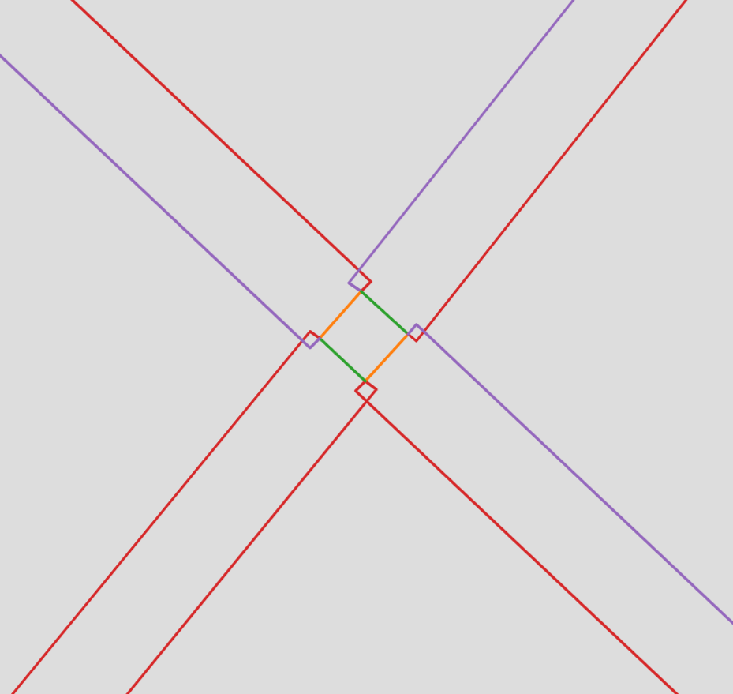

# Further work

Although I am very happy with the current state of `luz-verde` (and I do not
plan on implementing any major changes), there are definitely some limitations
to the package which I would like to address, alongside certain aspects that,
while not essential, may merit further work.

## Data quality

The most important factor towards determining the usefulness of the resulting
crossing graph is the quality of the OpenStreetMap data for the study area. It
is important to note, however, that not all data is equally useful. For
example, a sidewalk that is mapped separately might give slightly more
accurate travel times, but if it's not present, the crossing graph will
generate its equivalent of a sidewalk on each side of the road. I believe
there are two data types that "make or break" the resulting crossing graph.

Firstly, it is vital to map as many pedestrian crossing locations as possible
(zebra crossings, traffic signals, or others). In places where there are
missing pedestrian crossings, entire areas of a city might be deemed
"unaccessible" because they are surrounded by major roads deemed uncrossable.
Pedestrian crossings do not need to be accompanied by a sidewalk in order to
function; it is enough to create a single node in the existing road, where the
crossing is located. It is also important to tag crossings correctly; for
example, in Santiago, multiple traffic signal crossings are incorrectly tagged
as "marked", which is used for uncontrolled/zebra crossings.

Secondly, it is important to properly tag the (non-)existence of sidewalks
along each road. Most roads are assumed to have sidewalks on both sides unless
otherwise stated, so those that don't need to be explicitly tagged. For roads
that are assumed to have no dedicated sidewalk (e.g. motorways), those that do
should be explicitly tagged as well. It is also important to add the tag
`sidewalk=separate` to roads whose sidewalks are mapped separately; if not,
the crossing graph will have duplicate sidewalks on each side. Lastly, some
roads have the `sidewalk=separate` tag when there is no separate sidewalk
mapped; these should be changed to `sidewalk=both`, or else the crossing graph
will not include them.

I will try to fix as many of these issues as possible in areas I visit
frequently (I would not feel comfortable editing streets I have never visited,
just based on online information).

## Efficiency

I vied to make the crossing graph generation as correct as possible (trying to
cover all edge cases), but I did not make a conscious effort to improve its
efficiency. There are multiple aspects to consider, including parallelization,
less reliance on pandas's `apply` method and more vectorization, and revising
the order of operations.

### Reducing crossing graph size

Another aspect to consider is the presence of "dangling edges" in the crossing
graph, which are created when a road ends abruptly without a crossing. In the
image below (from Providencia, Santiago), Eliodoro Yáñez (which doesn't have a
separate sidewalk mapped) ends in the middle of an intersection. The
pedestrian crossings were before the intersection, so the actual intersection
doesn't allow crossing, and thus these edges end up with no connection (and
are functionally useless, since they don't lead anywhere).

I believe these dangling edges are only generated when the intersecting road
has separate sidewalks, though I am not 100% sure. It would be interesting to
see how many dangling edges exist on a given map, how much effort it would
take to filter them out, and whether doing that has a major impact on the
final graph size. It would also be interesting to see if there are any other
ways to make the crossing graph smaller.

## Better geometries

The image below shows the edges present in a fully crossable intersection
(where all roads are minor, and thus you can cross from any corner to any
adjacent corner). Because the intermediate nodes do not sit on top of the
buffered edges, they are connected by straight lines, which makes all crosses
jagged even when they shouldn't be. The scale at which this happens is really
small (opposite sides of a road are only 2 meters apart, so the "jaggedness"
adds no more than a couple of centimeters to the total travel length), but it
is still something to consider improving. One way that this might be improved
is by pushing the intermediate nodes further away, so that they land on the
intersection between their corresponding edges (I cannot easily think of a way
to do that, though).

Another issue (which was mentioned previously) is that nodes that are too
close to one another might get connected incorrectly because of the way the
edge geometries are generated (see [Buffer distance
choice](03_geometry.md#buffer-distance-choice) for more information). This
could perhaps be fixed by simply connecting nodes with a straight line if they
are too close to one another.

## More customizability

Lastly, it would be positive to add more customizability to the way the
crossing graph is generated. Currently, you can change what types of ways are
considered major/minor/pedestrian roads, as well as which crossing types are
safe or unsafe. However, you might want to make a certain type of way
major/minor under certain conditions (e.g. tertiary roads are major if they
are two-way, and minor if they are one-way), or make a crossing type safe
under certain conditions (e.g. unmarked crossings are only safe along minor
roads). You can currently achieve the latter by deleting edges after the fact
(using the `filtering` module), but there is no way to achieve the former,
since the `oneway` attribute does not exist in the crossing graph. Being able
to easily customize the crossing graph (either by passing parameters to
`generate_crossing_graph`, or by being able to filter out edges more
precisely) would probably make the resulting graph more realistic and useful
for many users.